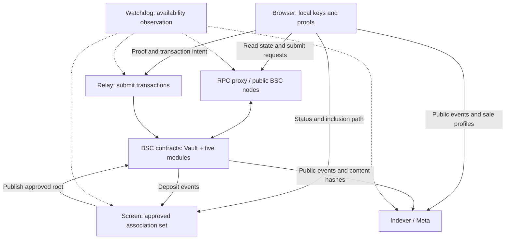

# HushCross

**Private-finance mechanisms on BNB Chain: one vault, five ways to use it.**

[中文](README.zh-CN.md) · [Website](https://hushcross.fun) · [Product docs](https://hushcross.fun/docs) · [Risk information](https://hushcross.fun/about) · [X](https://x.com/hushcross)

This repository contains source-available contracts, deployment sources and mechanism documentation. The web client and backend implementations are not included.

> **Current status — 18 October 2026:** the listed contracts are deployed on BSC mainnet (chain ID 56). The public website is in **demo mode**: displayed balances and activity are sample data, not connected funds. Contract deployment, a working demonstration and production availability of every client/service workflow are different claims.

## Why it exists

An ordinary public-chain payment exposes its sender, recipient, amount and time. HushCross combines shared privacy pools, local zero-knowledge proofs and one-time receiving addresses to reduce direct transaction linkage. Sealed commitments also keep selected bid/order terms hidden until reveal. Neither mechanism removes public chain records or prevents all statistical, network or operational correlation.

## Six features

### Vault

Deposit BNB or USDT into Privacy Pools and hold a private note. Spending proves ownership and membership in the current approved association set without identifying the deposit in the proof. Standard amounts are a client convention, not a restriction enforced by every underlying withdrawal path. [Vault details](docs/modules/vault.md).

### Send

Send from a vault note to a plain address or a one-time address derived from a Hush ID. ERC-5564 announcements help the recipient discover payments; ERC-6538 provides the public stealth meta-address registry. A relay may submit the transaction and fund an optional BNB stipend. Plain-address payments do not acquire a new recipient address. [Send details](docs/modules/send.md).

### Gift

Create new notes controlled by a gift secret and share that secret in a URL fragment. The same adapter can move a gift into a recipient's own vault. This is a bearer-secret mechanism: anyone who retains the secret can attempt to spend, including the sender. App expiry and one-share-per-person presentation are not on-chain exclusivity guarantees. [Gift details](docs/modules/gift.md).

### Launch

Commit a sealed bid, reveal it and settle a token sale at a validated uniform price. Successful sales charge a protocol fee and allocate configured proceeds and token reserves toward locked liquidity, subject to the contract's calculations. Failed or unspent escrow follows different private-funded and public-funded refund paths; fallback payouts can be public. Sale descriptions and logos are hosted off-chain and checked against hashes set through `LaunchFactory.setProfile`. [Launch details](docs/modules/launch.md).

### Book

Submit sealed limit orders to a periodic double auction. A batch takes commitments for 8 minutes and reveals for 2; settlement checks a maximum-volume price with an oracle band. Market, side and escrow information are visible at commitment time; not every order field is hidden. Filled proceeds go to the recipient, while eligible unused vault-funded escrow can return to the vault. Carrying an already revealed order does not make it secret again. [Book details](docs/modules/book.md).

### Give

Tip immediately or contribute to a goal with a target and deadline. Goal funds wait in escrow, then require settlement and release or per-contribution refunds. Private-funded refunds may create new vault notes; public funding refunds and certain fallback/dust payments are public. Give has no module fee, but relay, gas and applicable vault redeposit fees remain. [Give details](docs/modules/give.md).

## How the components fit

The intended client handles recovery material and proof secrets locally; service requests still reveal metadata. Simple and Pro are interface styles, not different custody or privacy models. See [architecture](docs/architecture.md) for what each service can observe and what happens when it is unavailable.

## Privacy boundaries and trust

- **Protected by the proof/commitment mechanisms:** a withdrawal proof does not identify which qualifying deposit is spent; sealed prices and other committed preimages are not published on-chain until reveal; recipient spending secrets are not needed by the relay.
- **Public or observable:** deposit senders, destinations, amounts, times, contract calls, commitment-time escrow/side information, revealed orders and clearing prices. RPC/service operators can observe request metadata such as IP addresses. Anonymity-set size, timing, reuse and funding patterns matter.
- **Critical withdrawal dependency:** notes deposited by Gift, sale, Book or Give contracts have no contract-provided `ragequit` entry point. Once successfully redeposited, these notes require an acceptable approved root and inclusion data. A public payout option before redeposit is not an escape route after redeposit.
- **Administrative trust:** Entrypoint is upgradeable and its owner controls important parameters. Other owner-controlled settings and oracle/service dependencies also matter. Do not assume a multisig or timelock merely from a future intention.

Delegated reveal is a separate disclosure: the chosen relay can decrypt its entrusted payload before the reveal window. Scheduling is not a cryptographic time lock.

Read [privacy](docs/privacy.md) and [trust and risks](docs/trust-and-risks.md) before relying on any flow.

## Fees

| Action | Fee / boundary | Basis |
|---|---|---|
| Vault deposit | Deployment default 0.30% check fee; configurable by the Entrypoint owner | [`DeployAll`](contracts/script/DeployAll.s.sol), upstream Entrypoint |
| Relay | Quoted before submission; deployment default maximum 1.5%, configurable | [`DeployAll`](contracts/script/DeployAll.s.sol), each adapter's validation |
| Launch | 1% of a successful raise | [`LaunchTypes`](contracts/src/launch/LaunchTypes.sol) |
| Book | 0.05% on each side of an executed trade | [`BookTypes`](contracts/src/book/BookTypes.sol) |
| Give | No Give module fee | [`GiveAdapter`](contracts/src/give/GiveAdapter.sol) |

Network gas and optional stipends are separate. Depositing refunded or gifted money back into a pool can incur the pool's check fee again. Parameters are not immutable promises: query the deployed contracts for current values.

## Mainnet contracts

| Contract | BSC mainnet address |
|---|---|
| Entrypoint (proxy) | [`0x202BDabF86E6B197Db716EE7f0c5a3E325D7058A`](https://bscscan.com/address/0x202BDabF86E6B197Db716EE7f0c5a3E325D7058A#code) |
| BNB privacy pool | [`0x23c49d9044585b69e37F3EcA04DA1237B8A2dA1d`](https://bscscan.com/address/0x23c49d9044585b69e37F3EcA04DA1237B8A2dA1d#code) |
| USDT privacy pool | [`0xC8df3f06Ab3114e56b5fa323efc5372fC0e719BD`](https://bscscan.com/address/0xC8df3f06Ab3114e56b5fa323efc5372fC0e719BD#code) |
| HushSendAdapter | [`0x141E36a85C71b4945965ea5a73a15270A8147296`](https://bscscan.com/address/0x141E36a85C71b4945965ea5a73a15270A8147296#code) |
| GiftAdapter | [`0xdC7339E0E562dbfCFc59506742241907F36f90ba`](https://bscscan.com/address/0xdC7339E0E562dbfCFc59506742241907F36f90ba#code) |
| LaunchFactory | [`0x698Fd53F18C6e73398877BDB919bF9287ea0adEB`](https://bscscan.com/address/0x698Fd53F18C6e73398877BDB919bF9287ea0adEB#code) |
| LaunchAdapter | [`0x16312F4A722a937aD756378f16A07c8506428676`](https://bscscan.com/address/0x16312F4A722a937aD756378f16A07c8506428676#code) |
| SealedBook | [`0x2EfA789972cadcE7a6A8D88B5Afc768217F67Fc7`](https://bscscan.com/address/0x2EfA789972cadcE7a6A8D88B5Afc768217F67Fc7#code) |
| BookAdapter | [`0x5Cc7abDcC9617e290ae9F9Ad85729A33AFC29aF3`](https://bscscan.com/address/0x5Cc7abDcC9617e290ae9F9Ad85729A33AFC29aF3#code) |
| GiveRegistry | [`0xdC276Fd8Ad4800D7Ee3D26940674aB4e5856d33e`](https://bscscan.com/address/0xdC276Fd8Ad4800D7Ee3D26940674aB4e5856d33e#code) |
| GiveEscrow | [`0x9db39F793Ac11d9deEa6f832736735A86daDdF5b`](https://bscscan.com/address/0x9db39F793Ac11d9deEa6f832736735A86daDdF5b#code) |
| GiveAdapter | [`0x88d6cb590253dF9eA6565160C65988d2cbCA1358`](https://bscscan.com/address/0x88d6cb590253dF9eA6565160C65988d2cbCA1358#code) |

The [verification guide](docs/verify.md) covers proxy implementation, verifiers and linked libraries as well. The [bytecode comparison](docs/bytecode-verification.md) states exactly which executable bytes and bindings were checked. It is not a security or service-availability guarantee.

## Build and independently check

Use the pinned dependencies and compiler described in [docs/verify.md](docs/verify.md). Run `forge build --offline --ast` from `contracts/` after installing those dependencies, then compare runtime code against BSC using the read-only verifier. Building or checking code does **not** require a wallet key and must not be confused with broadcasting the deployment scripts.

Deployment sources retain the mainnet confirmation guard and omit local mock-deployment branches. [Contract reference](docs/contracts.md) explains the contracts and libraries. [FAQ](docs/faq.md) covers recovery, failures and the scope of this repository.

## License

HushCross-authored contracts marked `BUSL-1.1` are **source-available**, not offered under an unrestricted open-source license before their Change Date. Licensor: **HushCross**. Additional Use Grant: **None**. Change Date: **2028-10-18**. Change License: **GPL-2.0-or-later**. See [contract license](contracts/LICENSE).

Original documentation, including both READMEs, is **CC BY 4.0**. Third-party files retain their own terms: the Privacy Pools subset includes Apache-2.0 core sources and GPL verifier sources; standard reference files are CC0-1.0. See [licensing map](LICENSE.md) and [upstream provenance](contracts/vendor/UPSTREAM.md). Source availability does not grant rights to the HushCross name or logo.

## Disclaimer

Smart contracts, cryptography, clients and services can fail. Public transactions are irreversible; lost recovery material may be unrecoverable. Token values can fall and liquidity can be unavailable. Nothing here promises returns, privacy against every observer or fitness for a particular purpose. You are responsible for applicable legal and tax obligations.
