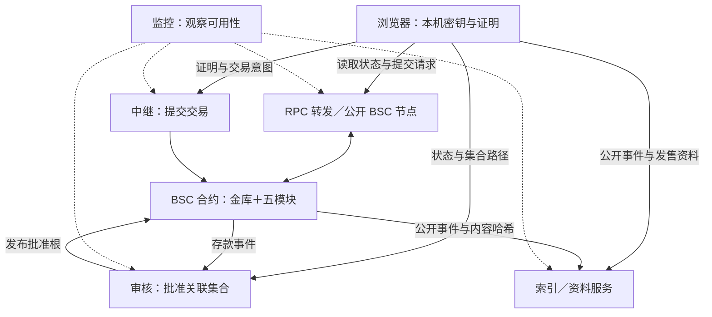

# HushCross

**BNB Chain 上的私密金融机制：一个金库，五种使用方式。**

[English](README.md) · [网站](https://hushcross.fun) · [产品文档](https://hushcross.fun/docs) · [风险说明](https://hushcross.fun/about) · [X](https://x.com/hushcross)

本仓库提供源码公开的合约、部署源码和机制说明，不包含网页客户端及后端服务实现。

> **当前状态 — 2026 年 10 月 18 日：**下表合约已部署于 BSC 主网（链 ID 56）。公开网站目前处于**演示模式**，余额与活动是示例数据，未连接真实资金。合约部署、演示界面可用和所有客户端／服务流程生产可用，是不同的结论。

## 要解决的问题

普通公开链付款会暴露付款方、收款方、金额和时间。HushCross 组合共享隐私池、本机零知识证明和一次性收款地址，减少直接交易关联；密封承诺在揭示前隐藏部分出价／订单条件。这些机制不会删除链上记录，也无法阻止所有统计、网络和运营层面的关联分析。

## 六个功能

### Vault：隐私金库

将 BNB 或 USDT 存入 Privacy Pools 并持有私密票据。花费时，证明票据所有权及其属于当前批准关联集合，而不在证明中指明对应存款。标准金额是客户端约定，并非所有底层提款路径都强制的限制。[金库详解](docs/modules/vault.md)。

### Send：私密发送

从金库票据付款到普通地址，或根据 Hush ID 派生的一次性地址。ERC-5564 公告帮助收款人发现付款，ERC-6538 提供公开隐身元地址登记。中继可以代为提交，并提供可选的 BNB Gas 补贴。付款到普通地址不会自动替换成新地址。[发送详解](docs/modules/send.md)。

### Gift：红包链接

创建由红包秘密控制的新票据，并通过 URL 片段分享秘密；同一适配器也能将红包换成领取人的金库票据。这是持秘密者可花费的机制：保留秘密的发送人或其他持有人都可能抢先花费。应用中的过期时间与每人一份，不代表链上独占保障。[红包详解](docs/modules/gift.md)。

### Launch：密封发售

提交密封出价、揭示，然后按合约校验的统一价格清算。成功发售收取协议费，并按合约计算将配置的所得和代币储备投入锁定流动性。失败或未花完的托管金额，按金库出资／公开出资走不同退款路径；回退付款可能公开。简介与 Logo 存放链下，读取时核对 `LaunchFactory.setProfile` 记录的哈希。[发售详解](docs/modules/launch.md)。

### Book：批次暗池

在周期性双边集合竞价中提交密封限价单。每轮提交 8 分钟、揭示 2 分钟，结算校验最大成交量价格与预言机保护带。市场、方向和托管信息在提交时可见，并非订单所有字段都隐藏。成交所得给收款地址，符合条件的金库出资未用托管可以回池。已揭示订单顺延后不会重新变成秘密。[暗池详解](docs/modules/book.md)。

### Give：私密打赏与众筹

即时打赏，或向有目标及截止时间的活动捐款。目标活动资金先托管，再由调用触发结算、发放或逐笔退款。金库出资退款可能生成新票据；公开出资退款以及部分回退／零头付款是公开的。Give 不收模块费，但中继费、Gas 和适用的再次存池审核费仍存在。[捐赠详解](docs/modules/give.md)。

## 工作原理与组件边界

客户端设计为在本机处理恢复材料和证明秘密，但服务请求仍会暴露元数据。Simple 与 Pro 是两种操作界面，不是不同的托管或隐私模型。[架构说明](docs/architecture.md)列出每个服务能观察什么，以及不可用时的影响。

## 隐私边界与信任前提

- **证明／承诺机制保护的内容：**提款证明不指明花费哪笔合格存款；密封价格等原像直到揭示才在链上公开；中继不需要收款人的花费秘密。
- **公开或可观察的内容：**存款发送人、去向、金额、时间、合约调用、提交时的托管额及方向、揭示订单与清算价格。RPC／服务可看到 IP 等请求元数据；匿名集规模、等待时间、地址复用和资金模式仍然重要。
- **关键提款依赖：**Gift、发售、Book 或 Give 合约代存的票据，没有由这些合约提供的 `ragequit` 入口。成功回池后仍需符合要求的批准根及集合数据。回池前的公开付款选项，不是回池后的退出通道。
- **管理权限：**Entrypoint 可升级，owner 可调整重要参数；还存在其他 owner 设置、预言机及服务依赖。不能因未来计划就假设已经有多签或时间锁。

委托揭示另有信息披露：受托中继可以在揭示窗口之前解密交给它的内容。定时调度不是密码学时间锁。

使用任何流程前，请阅读[隐私原理](docs/privacy.md)及[信任与风险](docs/trust-and-risks.md)。

## 费用

| 操作 | 费用／边界 | 来源 |
|---|---|---|
| 金库存入 | 部署默认审核费 0.30%，Entrypoint owner 可修改 | [`DeployAll`](contracts/script/DeployAll.s.sol)、上游 Entrypoint |
| 中继 | 提交前报价；部署默认上限 1.5%，可修改 | [`DeployAll`](contracts/script/DeployAll.s.sol)、各适配器校验 |
| Launch | 成功募集额的 1% | [`LaunchTypes`](contracts/src/launch/LaunchTypes.sol) |
| Book | 实际成交额的每边 0.05% | [`BookTypes`](contracts/src/book/BookTypes.sol) |
| Give | 不收 Give 模块费 | [`GiveAdapter`](contracts/src/give/GiveAdapter.sol) |

链上 Gas、可选补贴另计。退款或红包重新存入池子时，可能再次收取池审核费。参数不是永不变化的承诺，应读取链上当前值。

## 主网合约

| 合约 | BSC 主网地址 |
|---|---|
| Entrypoint (proxy) | [`0x202BDabF86E6B197Db716EE7f0c5a3E325D7058A`](https://bscscan.com/address/0x202BDabF86E6B197Db716EE7f0c5a3E325D7058A#code) |
| BNB privacy pool | [`0x23c49d9044585b69e37F3EcA04DA1237B8A2dA1d`](https://bscscan.com/address/0x23c49d9044585b69e37F3EcA04DA1237B8A2dA1d#code) |
| USDT privacy pool | [`0xC8df3f06Ab3114e56b5fa323efc5372fC0e719BD`](https://bscscan.com/address/0xC8df3f06Ab3114e56b5fa323efc5372fC0e719BD#code) |
| HushSendAdapter | [`0x141E36a85C71b4945965ea5a73a15270A8147296`](https://bscscan.com/address/0x141E36a85C71b4945965ea5a73a15270A8147296#code) |
| GiftAdapter | [`0xdC7339E0E562dbfCFc59506742241907F36f90ba`](https://bscscan.com/address/0xdC7339E0E562dbfCFc59506742241907F36f90ba#code) |
| LaunchFactory | [`0x698Fd53F18C6e73398877BDB919bF9287ea0adEB`](https://bscscan.com/address/0x698Fd53F18C6e73398877BDB919bF9287ea0adEB#code) |
| LaunchAdapter | [`0x16312F4A722a937aD756378f16A07c8506428676`](https://bscscan.com/address/0x16312F4A722a937aD756378f16A07c8506428676#code) |
| SealedBook | [`0x2EfA789972cadcE7a6A8D88B5Afc768217F67Fc7`](https://bscscan.com/address/0x2EfA789972cadcE7a6A8D88B5Afc768217F67Fc7#code) |
| BookAdapter | [`0x5Cc7abDcC9617e290ae9F9Ad85729A33AFC29aF3`](https://bscscan.com/address/0x5Cc7abDcC9617e290ae9F9Ad85729A33AFC29aF3#code) |
| GiveRegistry | [`0xdC276Fd8Ad4800D7Ee3D26940674aB4e5856d33e`](https://bscscan.com/address/0xdC276Fd8Ad4800D7Ee3D26940674aB4e5856d33e#code) |
| GiveEscrow | [`0x9db39F793Ac11d9deEa6f832736735A86daDdF5b`](https://bscscan.com/address/0x9db39F793Ac11d9deEa6f832736735A86daDdF5b#code) |
| GiveAdapter | [`0x88d6cb590253dF9eA6565160C65988d2cbCA1358`](https://bscscan.com/address/0x88d6cb590253dF9eA6565160C65988d2cbCA1358#code) |

[核验指南](docs/verify.md)也覆盖代理实现、验证器与链接库。[字节码对照表](docs/bytecode-verification.md)说明实际核对了哪些执行字节与绑定；这不构成安全性或服务可用性保证。

## 自行编译与核验

按 [docs/verify.md](docs/verify.md) 安装固定依赖及编译器，然后在 `contracts/` 运行 `forge build --offline --ast`，再用只读核验工具对比 BSC 链上运行时代码。编译与核验不需要钱包私钥，不等于广播部署脚本。

导出部署源码保留主网确认保护，移除了本地 Mock 部署分支。[合约说明](docs/contracts.md)介绍各合约与库，[常见问题](docs/faq.md)说明恢复、失败路径及本仓库范围。

## 许可证

标为 `BUSL-1.1` 的 HushCross 自写合约在转换日期前属于 **source-available（源码公开）**，不是不受限制的开源授权。许可人：**HushCross**；额外使用授权：**None**；转换日期：**2028-10-18**；转换后许可证：**GPL-2.0-or-later**。详见[合约许可证](contracts/LICENSE)。

原创文档及两份 README 使用 **CC BY 4.0**。第三方文件保留各自许可：Privacy Pools 子集包含 Apache-2.0 核心源码与 GPL 验证器；标准参考文件使用 CC0-1.0。详见[许可分区](LICENSE.md)及[上游来源](contracts/vendor/UPSTREAM.md)。源码公开不授予 HushCross 名称或标志的商标权。

## 免责声明

合约、密码学、客户端及服务可能出现缺陷。链上交易不可逆，遗失恢复材料可能无法找回资金。代币可能贬值，流动性可能不足。这里不承诺收益、对所有观察者的隐私或特定用途的适用性。使用者需自行遵守适用法律与税务义务。
