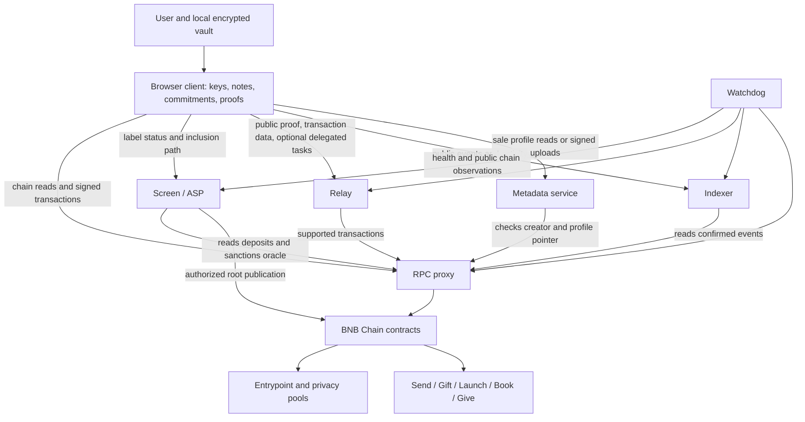

# Architecture and trust boundaries

HushCross separates local key handling, on-chain enforcement and hosted coordination. This document describes those responsibilities. Only the contract source and documentation are published here; the client and service implementations remain outside this source-available repository.

The [website](https://hushcross.fun) is a demo with sample data as of 18 October 2026. The independently deployed mainnet contracts are listed in the [README](../README.md). A component in the diagram is not a claim that the demo is executing live transactions.

## Components

## Local client

The client derives note and stealth-payment keys from a recovery phrase. Unlocking and zero-knowledge proof generation take place on the user's device. Local persistence is encrypted: the account design uses a passkey with WebAuthn PRF support where available, or a password-derived encryption key as a fallback. An encrypted backup is another sensitive copy, not a server-side recovery account.

The ordinary transaction flow sends public proofs and contract-call data, not the recovery phrase, wallet private keys or private note witness. This boundary does not mean that every secret is kept from every other party: a gift link intentionally shares a bearer secret, and delegated reveal gives the relay the information needed to reveal the bid or order. Browser compromise, malicious client code or an unsafe backup destination can defeat local protections.

## Hosted services

Network-facing services and their infrastructure can observe request metadata, including IP addresses and timing. The following describes what a service receives or can derive in its intended protocol role, not a guarantee against inference or a claim about log-retention periods.

| Service | Responsibility | Information visible to it | Information not supplied by the ordinary flow | Failure and available alternatives |
|---|---|---|---|---|
| `rpc-proxy` | Route chain reads and broadcasts to suitable BSC RPC providers; reject unsupported public requests and avoid accepting unverified historical-log responses. | Requested addresses, contract calls, log filters, block ranges, signed transaction bytes and network metadata. Selected upstream providers see the requests routed to them. | Recovery phrases, private signing keys and private zero-knowledge witnesses. Public transaction data can still support correlation. | An independent compatible BSC RPC can be used by suitable client tooling. Historical recovery requires sufficient log coverage. A missing or failed response must not be treated as a zero balance or an empty history. |
| `screen` | Read deposits, evaluate the configured sanctions oracle and approved contract-deposit rules, construct the association set, serve status and inclusion paths, and arrange authorized root publication. | Public depositors, amounts, labels, source transactions, screening outcomes and labels requested by clients. | Note nullifiers and secrets, stealth spending keys and the hidden deposit selected by a valid withdrawal proof. The service can still correlate a client's label queries with its deposits. | Private spending needs a usable inclusion path against the **latest** published association root. An original-depositor public exit may be available for a direct deposit. There is no equivalent user-callable ragequit for a successfully created contract-deposited note. |
| `relay` | Validate supported jobs, quote fees, submit transactions, track their state and perform opted-in reveal or claim tasks. It can provide supported gas top-ups. | Destination, asset, amount, fees, proof and public inputs, job timing and client network metadata. A delegated reveal also exposes the supplied bid/order preimage to the relay when it decrypts it. | The account recovery phrase and wallet signing keys; private note witness data is not needed to submit a completed proof. | A capable user or another compatible submitter can invoke permissionless contract actions with the necessary proof or preimage and gas. This is not a guaranteed built-in UI fallback. Inspect an existing job and transaction before retrying: a lost response does not prove that nothing was broadcast. |
| `indexer` | Turn public contract events into searchable activity, sale/campaign/order history and relevant ERC-5564 announcements. | Indexed on-chain records and clients' requested filters, ranges and pages. | Private view/spend keys and the local decision that an announcement belongs to a particular account. Query patterns may reveal interest in an address or event. | The chain remains authoritative. Compatible tooling can reconstruct state from contracts and historical logs. Missing or delayed indexed results do not cancel an order or establish an available balance. |
| `meta` | Host creator-authorized sale profiles and processed logos; serve content-addressed documents referenced by LaunchFactory. | Submitted profile text, links, image uploads, creator authorization and request metadata. This is publishing information, not private message storage. | Wallet recovery material or sale-bid secrets. Profile authorization is not a spending-key upload. | A missing, moderated or hash-mismatched profile should use the neutral display fallback. The sale's on-chain terms remain inspectable. A content hash establishes byte integrity, not the truth of marketing claims. |
| `watchdog` | Observe service health, index/screen progress, root-publication state and public operational account balances; notify operators about failures and recovery. | Health summaries and the public chain observations it checks. | User recovery material, private note witnesses and private wallet contents. | Its failure removes monitoring and alerts; it does not itself settle transactions, publish roots or create an exit path. On-chain and service state must be checked independently. |

## Main data flows

### 1. Deposit and approval

A user prepares a precommitment locally and funds a registered pool through Entrypoint. The deposit and its source transaction are public. Screen evaluates the deposit and builds its approved set. An authorized postman publishes a root to Entrypoint. The client needs the appropriate pool-state path and association-set path to prepare a private spend.

For recognized contract deposits, Screen applies the product-specific acceptance rules rather than treating all contracts as trusted. For example, the gift path requires evidence of a qualifying withdrawal and redeposit. Expected automatic approval is a service policy and availability dependency, not a pool-level guarantee that the label can always be spent.

### 2. Prove and submit

The browser creates a withdrawal proof bound to the selected pool and processor data. The processor may be Entrypoint or a product adapter. The relay checks a supported request and submits it. The pool checks the proof, known state root, current association root and unspent nullifier; the adapter checks its target, asset, fee and balance conditions before delivering funds.

A successful proof hides which eligible deposit was selected. It does not hide the processor, recipient, amount, fee, timing, public outputs or network request. Contracts may revert, and a broadcast can remain pending or have an uncertain client-side status.

### 3. Reveal, clear and claim

Launch and Book accept commitments before their reveal stages. Public escrow and commit calldata are not encrypted; Book's market, side and escrow are already visible. The protected preimage terms become public on reveal. A relay authorized to reveal must be trusted with the delegated preimage and timely submission.

Settlement proposals are checked on-chain. Claims pay the recorded recipient and apply the refund rules for the funding route. Book fill proceeds go to the recipient, not into a new vault deposit; only eligible unused vault-funded escrow is returned to the vault.

### 4. Return funds to the vault

A refund transaction can attempt new pool deposits and pay a remainder publicly. Some contracts provide recipient-controlled direct-payout alternatives or handle particular deposit failures by paying that portion to the recorded recipient. These paths act **before or instead of a successful redeposit**.

Once GiftAdapter, SealedSale, SealedBook or GiveEscrow successfully creates a pool note, that contract is the original depositor. The user cannot later convert that note into an original-depositor ragequit. A successful refund transaction therefore does not imply that its new notes are immediately spendable. See [trust and risks](trust-and-risks.md).

## Administrative authority

Entrypoint is a UUPS-upgradeable proxy. Its owner role can authorize upgrades, administer roles, configure or remove pools, wind down pools and withdraw accrued check fees. The ASP postman role controls root publication. LaunchFactory and SealedBook also have their own configuration and ownership powers, described in [contracts](contracts.md).

These powers can affect system behavior and availability without learning a user's recovery phrase. Local key custody must not be described as an unconditional promise that administrators cannot affect funds. Do not assume a multisignature or time delay merely because the interfaces support ownership changes; inspect the current on-chain administration.

## Publication boundary

This repository allows inspection of the disclosed contracts and dependencies. It does not provide a self-hostable copy of the private website or services. Describing service responsibilities does not publish their operational configuration, credentials or implementation.

Documentation: **CC BY 4.0**. Contract and dependency licenses are described in the [README](../README.md).

Delegated-reveal privacy boundary: the entrusted relay can decrypt the submitted preimage **before the reveal window**. Delaying its broadcast is an operational schedule, not a cryptographic time lock.
